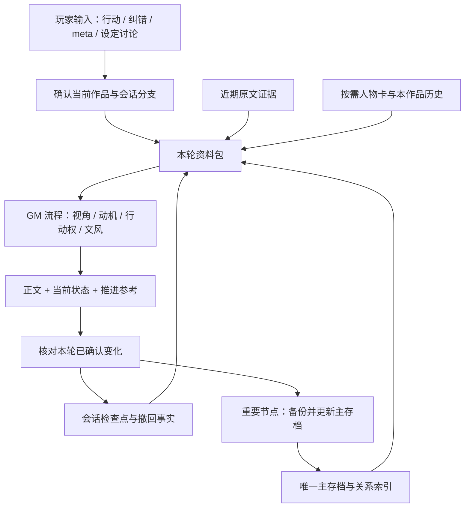

# Hermes TRPG Specialist：长线文字跑团特化方案

本 fork 面向需要持续多次会话的中文文字跑团、互动小说和世界观共建。专业化的重点是持续维护一个可发展的故事：人物知道什么、想要什么、刚做过什么，以及下一步由谁决定。

方案源于维护者的 Hermes `technical` profile 实践，公开版本抽取通用流程，使用独立虚构示例。Hermes 的模型接入、会话、工具、网关和技能机制由 Nous Research 上游提供；本 fork 贡献跑团方法、技能、模板与评估设计。

## 从常见失误到设计选择

| 跑团失误 | 设计选择 | 玩家体验 |
| --- | --- | --- |
| 换会话后回到旧场景 | 对照检查点、近期原文和主存档，保留来源 | 从最近有效动作接续 |
| 不同作品的人物、能力串线 | 明确作品绑定与唯一文件入口 | 比较另一部作品时不会误切换 |
| NPC 突然知道未传递的信息 | 逐角色记录已知、未知、传递通道 | 秘密、误会和调查有真实作用 |
| 所有人说话像会议发言 | 独立诉求、动作与具体物件承载对白 | 同一冲突里出现不同反应 |
| GM 替玩家表白、离场或睡到次日 | 区分 PC 行动权、NPC 行动权和作者指导 | 玩家掌握关键决定与节奏 |
| 纠正过的错误又被历史召回带回来 | 记录撤回事实，保留修正来源 | 后续场景使用修正后的事实 |
| 文笔流畅但无法判断剧情是否推进 | 每轮附当前状态与可选行动 | 玩家能检查断点并自由决策 |

## 架构：人格、流程、事实与恢复



### 1. 稳定人格与通用 GM 流程

`SOUL.md` 管写作原则，技能管操作流程。作品的角色口癖、关系与世界规则放在项目目录，避免把某个战役的偏好写成所有作品都必须遵循的定律。人格和技能在新会话加载；每轮变化的状态通过文件读取或插件的当轮上下文提供。

### 2. 按事实类别选择来源

最新明确的用户修正具有优先权。身份与世界规则查已确认设定；位置、时间、物品和行动查最新有效检查点及原文；关系查当前关系索引；旧摘要与历史检索用于补证。较新的一段助手正文仍可能被否定，不能仅按时间戳认定为正史。

分开记录四类内容：已接受的故事事实、角色的主观说法、尚未确认的构思、已撤回的错误。NPC 可以说谎；人物台词不等于客观事实。

### 3. 角色认知与独立动机

人物卡同时记录稳定身份、当前诉求、资源与底线，以及已知/未知信息。一次秘密传播需要具体通道：当面告知、短信、可靠目击或可解释的推断。作者知道的设定不会自动进入 NPC 认知。

独立动机通过可观察行动表现：争取资源、隐瞒线索、试探条件、主动离场。关系变化需要事件作为过渡，不能为了方便续写突然让人物改变立场。

### 4. 玩家行动权与叙事节奏

GM 负责 NPC、环境和后果；玩家负责 PC 的关键行动、台词与内心决定。`meta:` 用于作者层的方向与设定，先记录为指导，等故事走到适当节点再实现。用户叫停正文进入设定讨论时，切换到讨论模式；确认存档后等待续跑指令。

每轮推进一个有意义的场景节拍。可选行动是参考，始终允许自定义。涉及游戏规则或掷骰时，使用本战役约定的系统，区分真实工具掷骰与双方约定的叙事裁定。

### 5. 文风校准形成纠错闭环

把“太像 AI”“对白不像她”转成可复用检查：是否在宣读人物设定、是否所有人依次表态、是否用抽象关系词替代具体诉求、是否跳过动作过程。用户提供的风格样本保留在该战役中；通用技能只保留方法。见[对白参考](../optional-skills/creative/text-rpg-gm/references/dialogue.md)。

## 本次公开内容与本地实现

| 层 | 本次仓库交付 | 使用方式 |
| --- | --- | --- |
| GM 工作流 | 可安装的 `text-rpg-gm` 技能 | Hermes 原生文件与历史搜索工具 |
| 起始资料 | 人格、战役、人物、关系和检查点模板 | 复制到独立 profile 与战役目录后填写 |
| 连续性设计 | 来源、撤回、版本、分支与恢复约定 | 文件模式人工/模型维护；插件模式可结构化执行 |
| 自动写作记忆 | 本地 `writing-memory` 插件的设计说明 | 插件源码和安装器不包含在本次公开包中 |
| 质量评估 | 可复现输入与判定标准 | 手工或后续评测工具逐项运行 |

### 本地 writing-memory 实现记录

2026-09-10 的改造清单记录了独立插件、作品映射、SQLite 状态库，以及人格与 GM 规则的更新。插件通过 Hermes `pre_llm_call` / `post_llm_call` hooks 提供资料和保存原文，使用 `writing_memory` 工具处理检查点与历史操作，没有为跑团修改 Hermes 核心。

- 每个会话绑定作品；同一聊天的新会话可以恢复绑定，其他聊天隔离。
- SQLite 保存分支检查点、版本历史、原文与事件。写入使用 `expected_revision` 检查旧版本冲突。
- 每轮组装主存档片段、检查点和最近三轮原文；超过预算后按需读取完整文件。原文记录用于恢复，不代表助手草案自动获准。
- 历史召回仅访问该作品的 Hindsight bank，失败时继续使用本地资料。只显式保留有来源的稳定事实；提交被接受与事实已可检索是不同状态。
- 正式存档在重要节点备份后更新，并回读核验；动态状态不会靠反复改写全局人格保存。

2026-10-30 的本地只读检查确认了原文和检查点持续写入，同时最近 100 条检索事件均为 `recall_unavailable`。因此这次发布将本地连续性机制与远端历史召回的状态分开陈述。没有进行模型盲评，也没有将主观改善换算为性能分数。详细验证范围见[评估与边界](trpg-specialist-evaluation.md)。

## 从公开模板开始使用

本 starter 使用文件工具维护状态，不依赖 Hindsight 或本地插件。它适合单会话写入一个战役分支；并发分支需要各自检查点与明确合并，JSON 中的版本字段本身不提供事务锁。

1. 获取本 fork 的代码，进入仓库根目录。通过已有 Hermes 安装创建独立 profile：

   ```text
   hermes profile create trpg --description "中文长线跑团与互动叙事 GM"
   hermes -p trpg setup
   ```

2. 找到新 profile 的实际目录。将仓库 `optional-skills/creative/text-rpg-gm/` 整个目录复制到该 profile 的 `skills/creative/text-rpg-gm/`。这是 fork 的本地技能；上游 `official/` 技能源不会自动包含它。
3. 将技能的 `templates/SOUL.md` 复制到新 profile 的 `SOUL.md`。若已有自己的人格，合并适用原则。
4. 在自己的战役项目根目录建 `campaigns/harbor/`，复制 `templates/campaign/` 的内容到其中。确认 `trpg_save.md`、`relationships.md`、`characters/lin.md` 和 `checkpoint.json` 使用同一作品标识与故事日期。改编示例时同步修改四处。
5. 运行 `hermes -p trpg chat`，在新会话中明确调用：

   ```text
   加载 text-rpg-gm。
   本次只使用 <战役目录的绝对路径>，项目 harbor，分支 main。
   读取 trpg_save.md、relationships.md、checkpoint.json 和当前在场人物卡。
   从唯一有效断点续跑。我先观察渡口的灯，暂时不开启信封。
   ```

6. 检查首轮是否停留在渡口、信封仍未打开、远处人物没有凭空知情。发送明确纠错后，要求它更新检查点并回读；再以相同项目路径开新会话检查恢复效果。

在 Telegram 上使用时，将同一 profile 的网关按 Hermes 正常流程配置，并在聊天中明确作品。仅安装这份技能不会建立跨聊天自动绑定。

## 导航

- [GM 技能](../optional-skills/creative/text-rpg-gm/SKILL.md)
- [连续性与恢复规则](../optional-skills/creative/text-rpg-gm/references/continuity.md)
- [评估案例与证据边界](trpg-specialist-evaluation.md)
- [上游 profile 文档](../website/docs/user-guide/profiles.md)
